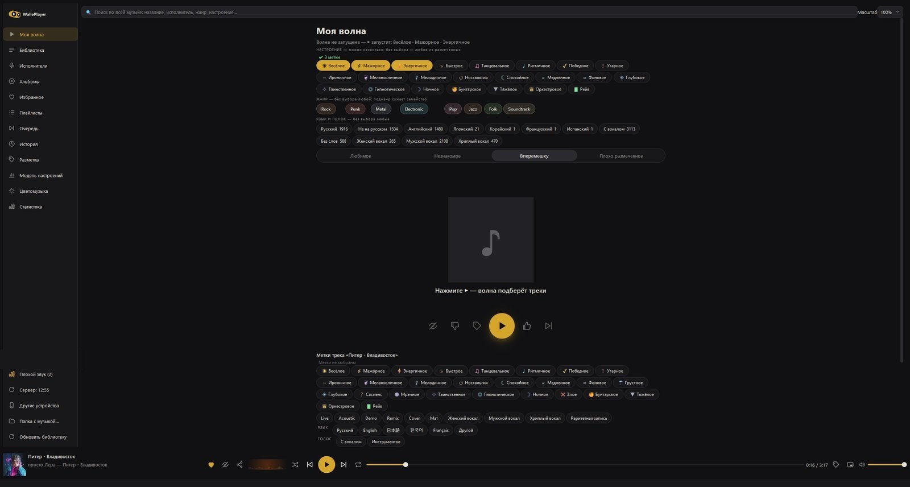
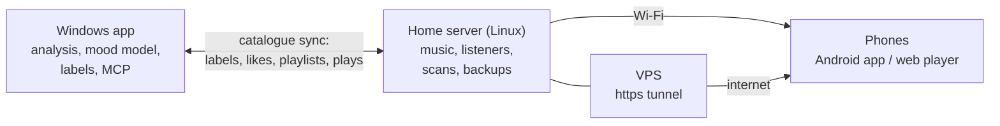
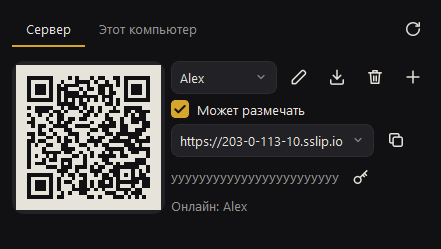
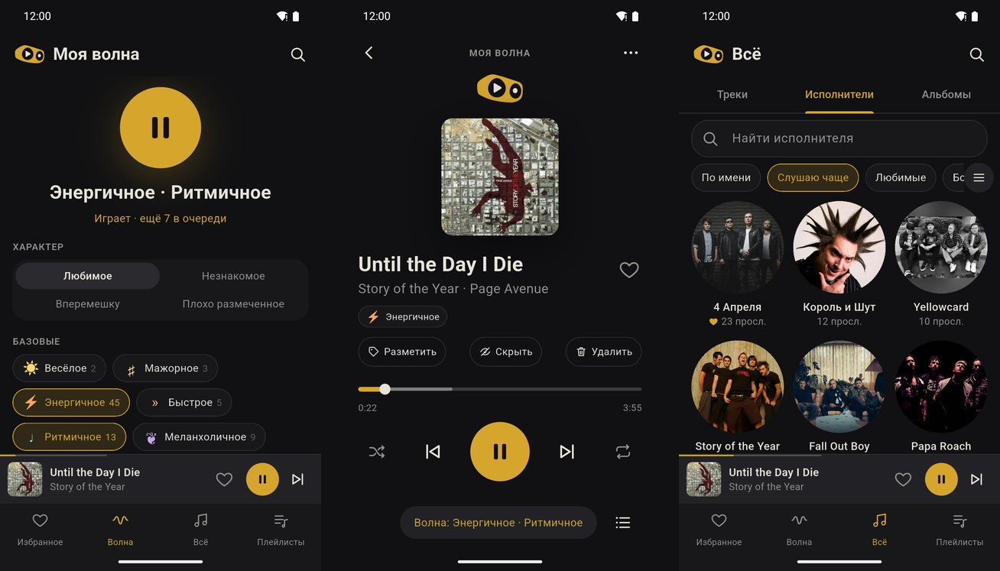
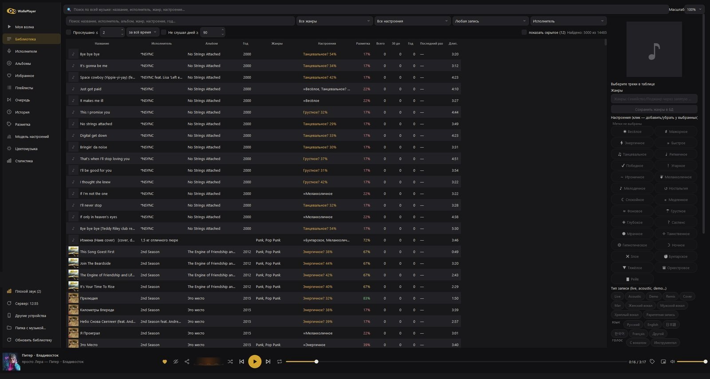
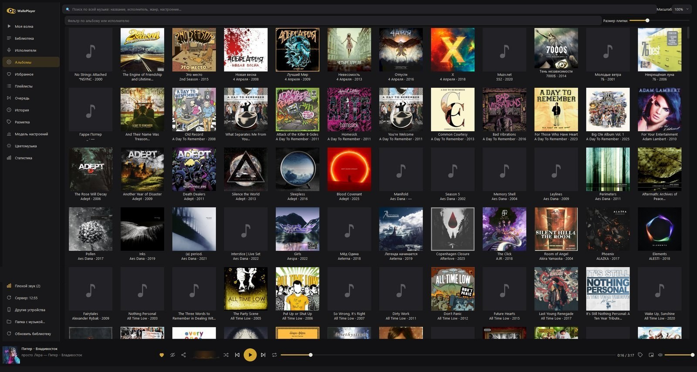

# Walle Player

A player and organizer for your own music collection: Windows desktop app, Linux home server, web player and
Android app. Moods are learned from your own labels, «My Wave» plays endlessly by mood, and the whole library is
reachable from your phone at home or over the internet. The music folder is read-only; file tags change only on an
explicit command, with a backup. The interface is in Russian.



## Platforms

| | |
|---|---|
| **Windows 10/11** | The main app: catalogue, player, mood model, labelling, statistics, MCP server for Claude. Installer in [Releases](https://github.com/mitay-walle/walle-player-desktop/releases). |
| **Linux server** | Optional always-on home box (`walle-server` systemd service): serves the music, keeps the listeners, scans, backs up the database, holds the tunnel to a VPS. |
| **Android** | Native app with Android Auto and offline downloads: [RuStore](https://www.rustore.ru/catalog/app/com.mitaywalle.player) or the APK in [Releases](https://github.com/mitay-walle/walle-player-desktop/releases). |
| **Web** | The same library in any browser; «Add to Home Screen» makes it an app (PWA). |

## How it fits together



- **Without a server** the Windows app shares the library itself (port 8780): open «Other devices», scan the QR code
  with the phone.
- **With a server** the PC keeps a synced copy of the catalogue: labels, likes, playlists and plays flow both ways;
  tracks missing on the PC stream from the server, or the PC keeps a full mirror (adds new files only, with a speed
  limit). Audio analysis and model training stay on the PC; the server only serves.
- **Listeners**: each person gets their own QR/link with separate likes and history; labelling rights are per
  listener. New devices can ask for access by name. The owner manages the server's listeners from the PC.
- **Internet**: a small VPS (SSH tunnel + Caddy https), a static IP via UPnP, or your own address —
  [docs/internet-access.md](docs/internet-access.md). API: [docs/remote-api.md](docs/remote-api.md).
- **Sharing**: a link to a track, album or artist opens in the Android app for anyone who already listens to the library.

| Other devices (PC) | Android |
|---|---|
|  |  |

## Features

- **Library**: fast search (FTS5, Cyrillic, prefixes), filters by genre, mood, plays per period, «not played for N
  days»; artists as a table or photo tiles; duets and «feat.» split into members; duplicate artists merged.
- **My Wave**: pick moods, genres, language or voice and a character (favourite / unfamiliar / shuffle) — endless
  playback. Some tracks are the model's guesses: 👍/👎 turns them into labels, so the model learns as you listen.
- **Mood model**: audio descriptors and CLAP embeddings (offline), honest validation across artists, calibrated
  confidence; zero-shot CLAP as a second opinion; similar tracks by sound.
- **Labelling feed**: the track plays from the middle, keys 1–0 pick moods, Enter confirms and moves on.
- **Order**: hide tracks, albums, artists or genres; «delete» marks from listeners; nightly sound-quality check
  (broken, truncated, transcoded files); like import from Spotify, Yandex Music, M3U, CSV.
- **Also**: smart playlists, statistics, mini-player, colour music from the live spectrum, UI zoom.




## Install

Windows: `WallePlayer-Setup-<version>.exe` from [Releases](https://github.com/mitay-walle/walle-player-desktop/releases),
no admin rights; uninstalling keeps the library data. SmartScreen may warn about an unknown publisher: «More info» →
«Run anyway».

Linux server: `python scripts/build_linux_server.py` → `dist/linux/walle-server-<version>.tar.gz`; on the server
`sudo ./install.sh`, then connect from the PC («Server» in the sidebar).

## From source

```
uv venv .venv --python 3.11
uv pip install --python .venv\Scripts\python.exe -e .[dev] numpy scipy soundfile librosa scikit-learn pyinstaller
run.bat
```

Playback uses libmpv: put `libmpv-2.dll` (64-bit, e.g. `mpv-dev-x86_64-*` from
[mpv-winbuild](https://github.com/shinchiro/mpv-winbuild-cmake/releases)) into `third_party\mpv\`.
Data lives in `%LOCALAPPDATA%\WallePlayer` (override with `MUSICPLAYER_HOME`). Headless: `python -m musicplayer.server`.

```
python -m pytest -n auto                                  # core + GUI (offscreen), parallel
.venv\Scripts\pyinstaller musicplayer.spec --noconfirm    # dist\WallePlayer\WallePlayer.exe
```

## MCP

The app runs an MCP server at `http://127.0.0.1:8766/mcp` (streamable HTTP), so Claude can search, play, label,
train the model and take screenshots; every action shows in the window. From a console:
`python scripts\mcp_call.py <tool> key=value ...`.

## Privacy

Nothing leaves the computer unless you ask: tag lookups (MusicBrainz, Last.fm), artist photos (Deezer, only the
artist's name is sent) and sharing the library with your own devices.

## License

[GPL-3.0](LICENSE). Includes [Qt for Python / PySide6](https://doc.qt.io/qtforpython-6/) (LGPL-3.0) and
[libmpv](https://mpv.io/) (GPL/LGPL).
